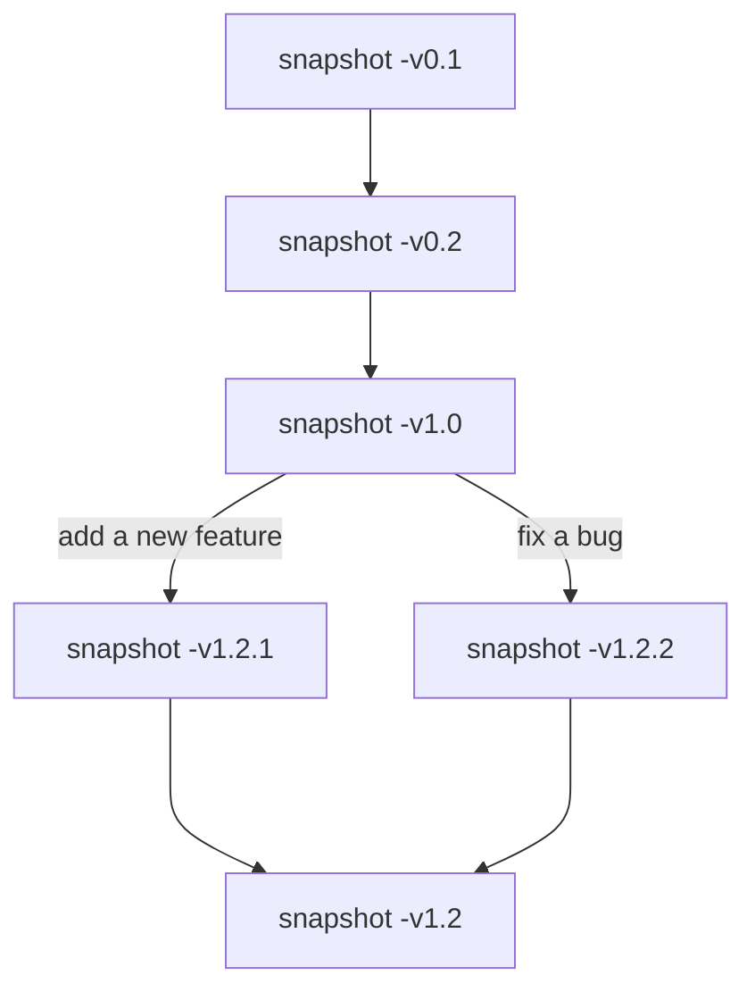

# Linux
## 1.Shell
+ `echo "\"Hello World\""` when using space(` `), add `\` or `""` or `''`

+ `which cmd` Show path of command

+ `$PATH` Environmental Variables

+ `pwd` Show current path 

+ in MacOS & Linux, use `/` to divide paths
  in Windows, use `\` to divide paths

+ `.` current dir   
  `..` parent dir

+ use Relative Path + Configure environment variables
  or use Absolute Path 

+ `ls` & `ls ..`
`-a`show all files, include hidden files
`-h`show in human readable storage style (400M, but 400000000)
`--color`show with colors

+ `cd ~`  to home dir
  `cd -` to the dir you are previously in

+ `-a` (no parameters): flag
  `-c argument`: option

+ under `ls -l`:
  First Letter: `d`:dir & `l`:symbolic link (link to another file/dir) & `-`:file
  Other 9 Letters: `rwxrwxrwx`:rights

+ `mv old/path/name new/path/name` (also be used to rename)

+ `cp old/path/name new/path/name`

+ `rm -r old/path/name` 
  `-r`: recursivly remove
  `remidr`: remove *empty* dir

+ `mkdir path/to/dir`

+ `man cmd` (like `--help`)

+ `clear` = Ctrl + L

+ `<` redirect input stream (rewrite) & `<<` append
  `>` redirect output stream (rewrite) & `>>` append
  

+ `cat` open file

+ eg.
  ```bash
  echo testContent > hello.txt
  cat [<] hello.txt
  ```
+ eg. (for copy contents)
  ```bash
  cat < hello1.txt > hello2.txt
  ```
  
+ pipe `|` : take output on the left as the input of the right

+ eg. 
  ```bash
  ls -l | tail -n 1
  ```

+ `/sys` a dir linking **Hardwares**, we can directly manipulate arguments/status of hardwares here

+ `tee`：get output in both the file and the termination

+ `sudo`

+ eg.
  ```bash  
  sudo echo 500 > brightness #Error Occurs

  sudo 500 | sudo tee brightness #That Works!
  ```
  >Explaination:
   `|`前后是独立的代码
   `<``>`后是需要重定向（输入输出）的文件，该重定向文件不接受`<`/`>`前的命令（`sudo`） 
   这里想给第二个命令用`sudo`，就是想用新的一个命令，故用`|`

+ `sudo su` change to root user
  `$` in head of every line will change to **`#`**      
  `exit` quit root user

+ `xdg-open` (Linux) & `open` (MacOS) & `start` (Win) : open a file use approprate software

+ `''`**forbid all** meaning-expansion inside
  `""`**allow all** meaning-expansion inside
  `/`**forbid** meaning-expansion for **next char**

+ Execute:
  directly execute: `./filename.sh` `./filename.py`:
  >operate system will check first line (Shebang line)(#!/......) of file, to search for explaination machine to run the file
  + its recommended to use `env` in Shebang to search in the $PATH, eg. `#!/usr/bin/env python`
  >this method check rights of exxecuting 
  
  indirectly execute: `sh semester.sh` `python filename.py`
  >omit the Shebang line

  >don't ask for right of executing 

## 2.Tools & Script
+ Define variable:
  `variable=value` #NO SPACE HERE!
  `echo $variable`

+ Function (only accessible for same lanuage as shell)
  write into a `name.sh` file
  `vim mcd.sh` manipulate on funtion
  `source mcd.sh` load the function
  `mcd test` invoke the function, use test as a argument

+ Strange arguments:
  `$0` - 脚本名
  
  `$1` 到 `$9` - 脚本的参数。 $1 是第一个参数，依此类推。
  
  `$@` - 所有参数
  
  `$#` - 参数个数
  
  `$?` - 前一个命令的返回值
  
  `$$` - 当前脚本的进程识别码
  
  `!!` - 完整的上一条命令，包括参数。常见应用：当你因为权限不足执行命令失败时，可以使用 
  `sudo !!` 再尝试一次。
  
  `$_` - 上一条命令的最后一个参数。如果你正在使用的是交互式 shell，你可以通过按下 Esc 之后键入 . 来获取这个值。
  
+ `echo $?` search for return value of last command
  `0` everything is Ok
  `1` error occurs

+ `A || B` only if A return 1, execute B
  `A && B` only if A return 0, execute B
  `A ; B` always execute A and then B

+ command substitution
  use an output of a cmd as a argument
  `variable=$(cmd)`
  `echo "We are in $(pwd)"`

+ process substitution
  `<(cmd)` the return of cmd will be wriiten into a temp file

+ Script (can run with all pointed languages)
  eg. (a script)
```bash
#!/bin/bash

echo "Starting program at $(date)"

echo "Running program $0 with $# arguments with pid $$"

for file in "$@"; do #iterate each argument

    grep foobar "$file" > /dev/null 2> /dev/null 
    #/dev/null is a place for causlly write, content output to here will be drop immediately 
    #1st > means output of the cmd, 2> means the error code of the cmd

    if [[ $? -ne 0 ]]; then #-ne not equals
    #better to use [[]] when verdicting
        echo "File $file does not have any foobar, adding one"
        echo "# foobar" >> "$file" #add a line as a notation
    fi
done
```
use `./name.sh` to run the script

+ wildcard 通配符
  `？` one char
  `*` many chars
  `{}` eg:
   `convert image.{jpg,png}`
  `mkdir foo{2,3}`
  `path{1,2}/file{1,2,3}` 6 paths with Cartesian product
  `*{.sh/.py}`
  ```bash
  mkdir foo bar
  touch {foo,bar}/{a..z} foo/a;foo/b;...;foo/z;bar/a;...;bar/z
  touch foo/x bar/y
  #compare different files included in "foo" and "bar"
  diff <(ls foo) <(ls bar)
  #return
  4c4
  < x
  ---
  > y
  ```

+ `shellcheck <script>`to get some instruction of the script/function

+ `tldr` a simple man

+ `find`
`find .` current dir
`-name foo`
`-iname`ignore upper and lower case
`-type d`
`-path "**/test/*.py"`
`-mtime -1`last modified time: in last 1 day
`-size +500k`
`-exec` eg:
`find . -name '*.tmp' -exec rm {} \;`
`find . -name '*.png' -exec convert {} {}.jpg \;`
>`{}` means the file find by `find` before
 `\` means the end of argument of -exec

+ a more simple way to look for sth.
`fd`
`fd "*.sh"`

+ a more rapid way, but can only search by keywords instead of attributes
`locate keywords`
use `updatedb` to update the batabase and indcies

+ look for things inside files
`grep`
`grep keywords filename`
`-v`invertly choose files
`-C 5`output 5 lines above and 5 lines below the found text
`-R keywords`filename:recursively search for all files in the dir

+ a more rapid and simple cmd
ripgrep (`rg`)
`rg "keywords" path`

+ look for history of cmd
`history`print all history
`history number`print number lines of latest history
`history | grep "foo"`

+ Ctrl + R : look for cmd using keyword in reverse order

+ `fzf` 
`cat example.sh | fzf` ---> type to search

+ `export variable=value`make the varable inside a script into the global variable

+ A script of exercise 3:
```bash
#!/usr/bin/env bash

count=0

while true; do
    output=$(./exercise2_3.sh 2>&1)

    #!!!清理输出中的换行符和多余的空白字符!!!
    cleaned_output=$(echo "$output" | tr -d '\n' | sed 's/^[ \t]*//;s/[ \t]*$//')

    echo "$cleaned_output" >> log.txt

    if [[ "$cleaned_output" == *"The error was using magic numbers"* ]]; then
        echo "Error Occurred, count is $count"
        break
    fi

    count=$((count+1))
done
```

+ `xargs` use the output of as argument of the following cmd
eg:
`ls | xargs rm`
`find . -name "*.HTML"  | xargs zip ./test/archive.zip`

## 3.Vim (the configration of vim is stored inside `~/.vimrc:`)
### Modes:
#### Normal Mode
+ `u` undo
  `<Ctrl> + r` recover the undo

+ `x` delete the char

+ `dw `delete a word
  `de` delete current char to e[nd] of the word
  `dd` delete the line

+ `h` `j` `l` `k` move

+ `w` `b` move to head of one word distance (forward or backward)
  `e` move to tail of one word distance

+ `0` move to head of a line
  `$` move to tail of a line
  `^` move to first non space char in a line

+ `<Ctrl> + u` page up
  `<Ctrl> + d` page down

+ `G` move to tail of the file
  `gg` move to head of the file

+ `<Shift> + l` move to last(lowest) line inside the scree
  `<Shift> + m` move to middle line inside the screen
  `<Shift> + h` move to first(highest) line inside the screen

+ `f char(case-sensitive)` move to (f[ind]) the latest next char in this line
  `F char(case-sensitive)` move to (f[ind]) the latest last char in this line

+ `t char(case-sensitive)` move t[o] one char before the latest next char in this line
  `T char(case-sensitive)` move t[o]  one char before the latest last char in this line

+ `r char` r[eplace] the current letter into another char

+ copy and paste (separated from the copy-paste board of the operating system)
  `y` y[ank]/copy: `yw` for word, `yy` for line
  `p` p[aste]

+ Count
  `number cmd` run cmd for number times
  eg:
  `4j`

+ Modifier (for `()/[]/''/""/...`)
  `i` i[nner]
  eg:
  `ci(` change text inside the `()`
 
  `a` a[round]
  `ci(` change text inside the `()` and the `()` itself

+ `%` move to `()/[]/...`

+ `/text` search text
  `n` move to next match

#### Insert Mode
+ `i` enter insert mode

+ `o` enter insert mode while opening a new line below the cursor
  `O` enter insert mode while opening a new line above the cursor

+ `ce` c[hange] current char to end of the word into ... (enter insert mode)
  `cc` c[hange] current char to end of the line into ... (enter insert mode)

+ `.` repeat the last insert

#### Vison Mode (`v`) & Vison Line Mode (`<Shift> + v`) & Vison Block Mode (`<Ctrl> + v`)
+ for select something

+ `~` convert all chars' cases (upper <-> lower)

#### Command Line Mode (`:`)
+ `:help cmd` eg. `:help :w`

+ **buffer**: a **unique** buffer area of a **unique** file, `:w` to overwrite the file with the buffer

+ **window**: a buffer(file) can have multile windows

+ `:q` close the upmost window
  `:qa` close all windows

+ `:e {filename}` open a new buffer(file)

+ `:ls` show buffers

+ `:sp[lit]` open a new window, but the same buffer(file): watch 2 diffierent parts of a same file
  `:vsp` open a new window vertically

## 4.Data Wrangling/Neatening/Managing
+ `journalctl` view the system-log of linux

+ `sed [-E]` a stream editor: edit a file in a cmd level, `-E` to make the cmd allow new regex expressions
  `s/Regex/Substitution/` replace content inside files
  `s/Regex/Substitution/g` execute as much times as possible

> `.` 除换行符之外的 “任意单个字符”
  `*` 匹配前面字符零次或多次
  `+` 匹配前面字符一次或多次
  `[abc]` 匹配 a, b 和 c 中的任意一个
  `()` Capture Group
  `(RX1|RX2)` 任何能够匹配 RX1 或 RX2 的结果
  `^` 行首
  `$` 行尾
  `\d`**不支持**

  eg:
  ```bash
  cat test.log | sed 's/.*Disconnected from //'
  cat test.log | sed 's/.*\(/\(/'
  cat test.log | sed 's/^.*\((.*)\).*$/\1/'
  cat test.log | sed -E 's/^.*[0-3][0-9] (..:..:..).*$/\1/'
  ```

+ `wc` word count
  `wc -l` count line number

+ `sort`
  `sort -n` numeric sort
  `sort -k1,1` only sort in 1(`n`) bolck of chars split by space(` `), to the 1(`,n`) block

+ `uniq` remove duplications
  `uniq -c` remove duplications and count the duplication number

+ `awk` a column based stream editor (automatically parse the input in space-separeated pattern)
  eg:
  `awk '$1 == 4 && $2 ~ /^2[0-4].*$/ { print $2 }'`
  <line>
  **awk is a program-language**
  eg:
  ```bash
  cat test.log | sed -E 's/^.*[0-3][0-9] (..:..:..).*$/\1/' | uniq -c | sort | awk 'BEGIN { row_count = 0 } $1 == 4 && $2 ~ /^2[0-4].*$/ { row_count += 1; print $2 } END { print row_count }'
  ```

+ `paste`
  `paste -s` paste many lines together split by tab
  `paste -d',` use new delimiter d`,` 
  eg:
  ```bash
  cat test.log | sed -E 's/^.*[0-3][0-9] (..:..:..).*$/\1/' | uniq -c | sort | awk '$1 == 4 && $2 ~ /^2[0-4].*$/ { print $2 } | paste -sd,
  ```

+ `bc` a cmd line calculator
  `bc -l` Define the standard math library (make bc cleverer)
  eg:
  ```bash
  echo 1+1 #1+1
  echo 1+1 | bc -l #2
  ```
  eg:
  ```bash
  cat test.log | sed -E 's/^.*[0-3][0-9] (..:..:..).*$/\1/' | uniq -c | sort | awk '$1 != 2 { print $1 }' | paste -sd+ | bc -l
  ```

+ Some exercises
  ```bash
  grep -v "'s$" /usr/share/dict/words | grep -i 'a.*a.*a' | awk '{print substr($0, length($0)-1, 2)}' | sort | uniq -c | sort -nr


  journalctl | grep "Startup.*=.*" | sed -E 's/^.*= ([0-9]+\.[0-9]+)s.$/\1/' | paste -sd+ | bc -l

  journalctl | grep "Startup.*=.*" | sed -E 's/^.*= ([0-9]+\.[0-9]+)s.$/\1/' | uniq -c | sort | head -1 | awk '{ print $2 }'
  ```

## 5.Command Line Environment
### Job Control
+ `Ctrl + c` send a signal of `SIGINT`
  `Ctrl + \` send a signal of `SIGQUIT` (Deeper Signal for Process Terminating)
  `kill -TERM <PID>` send a signal of `SIGTERM` (a more elegent way for termination)

+ to prevent process stopped by `SIGINT`:
  ```bash
  #!/usr/bin/env python
  import signal, time

  def handler(signum, time):
    print("\nI got a SIGINT, but I am not stopping") # print sth to shoe a signal is received

  signal.signal(signal.SIGINT, handler) # when receiving a SIGINT, invoke the handler function using the signal as its argument, instead of respond to the signal itself
  i = 0
  while True:
      time.sleep(.1)
     print("\r{}".format(i), end="")
     i += 1

  # use <Ctrl + /> to quit
  ```

+ `Ctrl + z` SIGTSTP to stop a process
  
+ `fg` continue the process in front desk
  `bg` continue the process in back desk
  `bg` %number number is the number inside [], to continue the process in back desk

+ `jobs` show all unfinished processes

+ `nohup` ignore `SIGHUP`, to make a process continue to run **even if the terminal(session) is closed**

+ `&` add this after **end** of a cmd to let it run in back desk

+ `kill %1` kill
  `kill -STOP %1` pause
  `kill -SIGHUP %1` or `kill -HUP %1` add `nohup` to `%1`
  `kill -TERM <PID>` send a signal of `SIGTERM` (a more elegent way for termination)

+ `ps -ef | grep keywords` to check pid
  `-e` for showing precesses for all users
  `-f` for showing full information
  
### Terminal Multiplexer
+ **Seisson** --contain--> **Window** --contain--> **Pane**

#### Session:
+ `tmux` open a new shell
  `tmux ls` show list of all sessions
  `tmux new -s name_for_session` start a session with a specified name
  `tmux attach -t name_for_session`
  `tmux kill-session -t name_for_session`

+ `Ctrl+b d` retrun to main session

#### Window (current window has a `*` after the window-name):
+ `Ctrl + b c` create a new window
  `Ctrl + b a` jump to previous window
  `Ctrl + b n` jump to next windoe
  `Ctrl + b number` jump to a specified window
  `Ctrl + b ,` then enter sth to rename current window
  `Ctrl + d` quit current window

#### Pane (all the manipulations are still executed in the same window):
+ `Ctrl + b "` vertically split
  `Ctrl + b %` horizontally split
  `Ctrl + b direction-arrows` move among the panes
  `Ctrl + b` space change layouts
  `Ctrl + b z` zoom the curent pane to full screen, type this again to recover
  `Ctrl + d` quit current pane

### Alias
+ `alias ll="ls -lah"` no space around `=` (only receive single argument)

+ `alias ll` check what an alia stands for

+ alias and be nestedly-used:
  ```bash
  alias la="ls -a"
  alias lal="la -l"
  ```
+ `unalias la` ban some alias

+ `/ll` unalia it THIS TIME and execute with its orinal meaning

+ current alias only work in current session, to make them globalized, we have to **write them into configuration files**
  eg:
  ```bash
  vim ~/.bashrc

  #set alias
  
  bash #restart bash
  ```

### Dot files (Configuration files)
+ `bash` - `~/.bashrc`, `~/.bash_profile`
  `git` - `~/.gitconfig`
  `vim` - `~/.vimrc`, `~/.vim`
  `ssh` - `~/.ssh/config`
  `tmux` - `~/.tmux.conf`

+ bash will automatically search for `~/.bashrc` for configuration file, so we can just weite a **symlink** in the `~/.bashrc` (eg: `ln -s real/path/to/configuration/file symlink`), then we can put **all of dotfiles** into a **dotfile repository** in place

## 6.Version Control
+ Version Control: Track the history of document changes

+ `git`

### Data Structure
+ trees(flolders) can contain trees(folders) and blobs(files)

+ git use **directed acyclic graph** to model history versions(snapshots)(commits)
  eg:

+ a git repository maintains 
    + an **array<Objects>** using hash values, object=commit|tree|blob
    + a **map<String_Hash, String_HumanReadable>** for reference

### Command Line
#### Basic
+ `git init` initialize a git repository (a `.git` folder will be automatically created)

+ `git help <cmd>` eg: `git help init`

+ Set your ID info first:
  + For current repository:
  ```bash
  git config user.name <"Your Name">
  git config user.email <"your.email@example.com">
  ```
  + For all repository:
  ```bash
  git config --global user.name <"Your Name">
  git confi --global  user.email <"your.email@example.com">
  ```

+ `git config --global core.editor "vim"` change the insert mode for commit-message files into vim

+ `git status`

+ `git add <new_file>` add file to git's **staging area**, which means it has been **tracked** by git (if git status again, this file's status changed)
  `git add -A` add all stuff into staging area
  `git add -p` then `s`[plit] changes into small changes, `y` to save the change, `n` to remove
  
+ `git commit` then write commit-messages, then a hash-number of the **commit** will be return

+ `git cat-file -p <Hash>` can query the info using hash-number 

+ `git log` show history in linear
  `git log --all --graph --decorate --oneline`

+ `master` the main branch in the project
  `HEAD` a pointer to the current commit

+ `git checkout <hash_id_or_its_prefix | reference_name>` move around in the commits, **the change made will be delete simultaneously**
  `git chechout -f <hash_id_or_its_prefix | reference_name>` drop the modifications of the files and move HEAD

+ `git diff <file_name>` to check out the change in this file **between HEAD and latest_modification** 
  `git diff <hash_id_or_its_prefix | reference_name> <file_name>` to check out the change in this file **between specified_commit and latest_modification** 
  `git diff <hash_id_or_its_prefix_1 | reference_name_1> <hash_id_or_its_prefix_2 | reference_name_2> <file_name>` to check out the change in this file **between specified_commit_1 and specified_commit_2** 

#### Branch
+ `git branch` list all the branches
  `git branch -vv` list all branches with details

+ `git brance <branch_name>` build a new branch (reference)
  `git bchechout -b <branch_name>` build a new branch (reference) and checkout to it

#### Merge
+ `git merge <branch>` merge current **to** `<branch>` ---> **2 results**
    + if only add new stuff to old commit: `Fast-forward` and success
     
    + if parallel development with imcompatible changes: `Automatic merge failed`: conflics are between
  ```bash
   <<<<<<< branch1
          ... #conflics
   =======
          ... #conflics
   >>>>>>> branch2
  ```
  ---> **3 methods**
    + `git merge --abort` undo the merge
  
    + fix the conflics **manually**, then `git add <file>`, then `git merge --continue` and write the commit-message to finish manually merging
  
    + use `git mergetool`

#### Remote Manipulation
 + `git remote` list all remotes

 + `git init --bare` initialize a repository that only store **metadata** (git_version/author_name/...) without work_dir

 + `git remote add <remote_name> <URL | path/to/remote>` link to a remote to local

 + `git push <remote_name> <local_branch>:<create_a_remote_branch>` push a local to remote
  
#### Other
+ `git clone <URL | path/to/remote> <path/to/destination>` get a clone of all commits of a remote from remote to local
  `git clone --depth=1 <URL | path/to/remote> <path/to/destination>` get a clone of only the latest commit of a remote (not usable in local for remotes)

+ `git fetch <name_of_remote>` sync the remote to local, but `HEAD` and `master` in the local repository won't move, hence we need an extra `git merge`
  `git pill` == `git fetch; git merge`

+ `vim ~/.gitconfig` git comfiguration

+ `git blame <file_name> `chech details(editor/time/...) of each change of a file

+ `git show <hash_number>` shoe detail of the object

+ `git stash` temporary remove the changes from last commit till now
  `git stash pop` recover the changes

+ `vim .gitignore` specifiy some files that will **never be tracked** by  git
  eg:
  add `*.class` as they are binary files in java compiling, we only want to store `*.java` can ignore `*.class`

## 7. Debugging and Profiling
### Debug
#### Method1 - printf
+ a script to show all the colors:
  ```bash
    #!/usr/bin/env bash
  for R in $(seq 0 20 255); do
      for G in $(seq 0 20 255); do
          for B in $(seq 0 20 255); do
              printf "\e[38;2;${R};${G};${B}m█\e[0m";
         done
     done
  done
  ```

+ use **log**
  system log store under `/var/log`
  use `lnav` to make the log more readable

+ show logs directly:
  + mac: `show log --last 10s` (or other time)
  + linux: `journalctl`

+ `logger "hello log"` write sth into log


### Method2 - Debugger
+ `ipdb` I_Ptyhon_DeBugger
  + `l` list all codes
  + `s` move a step
  + `restart`
  + `c` continue move until issue or breakpoint
  + `p <item>` print the item
    `p` locals() print all variables and values
  + `q` quit
  + `b <line_number>` set a breakpoint at a certain line

### Method3 - Staic Analysis Tools
+ `pyflakes3 <file_name.py>`
+ `mypy <file_name.py>`

### profiling
#### Method1 - Time Counting
#### Method2 - Profilers

+ Tracing Profiler: keep tracing
  Sampling Profiler: fetch samples discontinuously

+  in python, we use `cProfile`: `python -m cProfile -s tottime example.py`

+ `tac` reverse of `cat`, print files from bottom to up

## 8.Meta Programming
### Dependence Management
+ `make` look for file inside a file called `Makefile` (the place to encode targets/dependenceies/rules)
  `make` with no target: build the 1st target by default
  `make` will only when the dependencies have been changed (only rebuild the necessary dependencies)

+ Syntax
  ```Makefile
  A:B C "A depends on B & C
    cmd "A cmd for A building

  ...
    ...
  ```

+ eg:
  ```Makefile
  paper.pdf: paper.tex plot-data.png
	  pdflatex paper.tex

  plot-%.png: %.dat plot.py "% is a wildcard for any char, and % again means the same object as the % before
	  ./plot.py -i $*.dat -o $@
  ```

+ `pdflatex` a tool to convert .tex to .pdf

+ `clean` of `make` for file/manipulation cleaning:
  eg:

  ```Makefile
  .PHONY: clean "tell Makefile 'clean' is not a file

  paper.pdf: paper.tex plot-data.png
      pdflatex paper.tex

  plot-data.png: data.dat plot.py
      ./plot.py -i data.dat -o plot-data.png

  clean: "undo all constructing steps in the commit and remove all the constructed files
      rm -f paper.pdf paper.aux paper.log
      rm -f plot-data.png
      rm -f $(shell git ls-files --others)
  ```
  then
  ```bash
  make

  make clean
  ```

### Semantic Version 语义版本号
+ X.X.X
  Major.Minor.Patch

+ no API change: Patch++
  API change & backward compatible: Minor++
  API change & not backward compatible: Major++

+ Lock File: a list of your dependencies

### Continous Integration System

### Test Terminologies
+ Test suite all test that runs as a unit

+ Unit Test: small test to a very particular thong

+ Integration Test: test interaction b/w subsystems

+ Refression Test: test those parts which caused bugs

+ Mocking Test: shield the thing that are not related to the test