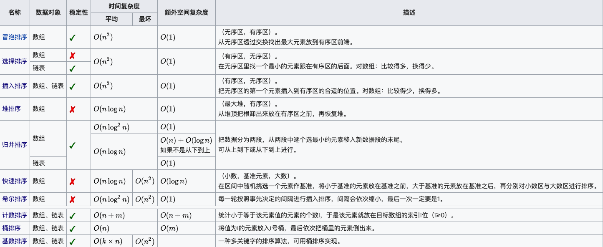

# [10 Classical Sort Algorithms](https://www.runoob.com/w3cnote/ten-sorting-algorithm.html)
> 

1. 冒泡排序

2. 选择排序

3. 插入排序

4. 希尔排序

5. 归并排序

6. 快速排序

7. 堆排序

8. 计数排序

9. 桶排序

10. 基数排序

---

- 完全二叉树&堆：